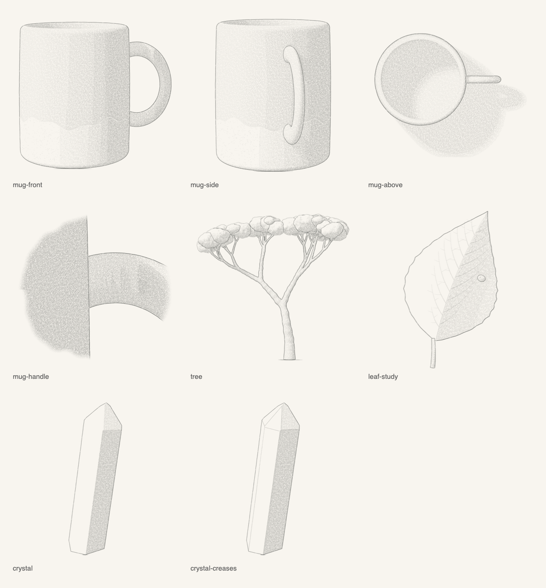

# Graphite

A pencil-drawing engine in Swift. You describe an object as a 3D signed-distance model; Graphite ray-marches it and
draws what it sees the way a hand draws it with a soft pencil: traced contours with a wobble and tapered ends, hatching
for the shade (light from the upper left), a sparse stipple, a short stroke on the ground, all deposited through the
tooth of the paper. The output is graphite on a transparent background, trimmed to its ink.

It started as the drawing engine of a game's field guide (stone lanterns, bridges, trees, birds, insects); this is that
engine on its own, with neutral examples. "Graphite" is a working name.



- Swift package, macOS 13+, no dependencies beyond Apple's frameworks (Foundation, CoreGraphics, ImageIO).
- Deterministic: the same model, view and seed give the same drawing, pixel for pixel.

## Quick start

```sh
swift build -c release
swift run -c release graphite            # renders the examples into Examples/output/
swift run -c release graphite mug        # or some of them: mug, tree, leaf, crystal
```

The examples are in [Examples/](Examples): [Mug.swift](Examples/Mug.swift) (a subject written from scratch, three views
and a detail), [Tree.swift](Examples/Tree.swift) (a tree grown by a small brancher on the primitive scene),
[Leaf.swift](Examples/Leaf.swift) (a close study drawn from 2D vector shapes) and [Crystal.swift](Examples/Crystal.swift)
(a faceted crystal as one region, drawn without and with creases).

## A minimal drawing

```swift
import Graphite

// A pebble: one ellipsoid on the ground, a bit lumpy.
let pebble = ShapeSubject()
pebble.add(.init(lo: V3(-0.6, -0.4, 0), hi: V3(0.6, 0.4, 0.5), grounded: true,
                 sdf: { p in sdEllipsoid(p - V3(0, 0, 0.2), V3(0.55, 0.38, 0.22)) + 0.01 * vnoise3(p * 9) },
                 material: { _, _, _ in Material(value: 0.25, stipple: 1.5) }))

let view = drawView(pebble, .elevation(az: -.pi / 2, eyeZ: 0.6, dist: 4))
writePNG(view.image, to: "pebble.png")
```

`drawView` frames the subject, marches it at two samples per pixel, draws it and trims it. `drawDetail(subject,
parent: view, target:, radius:)` draws a closer study of a point of a view and tells you where to ring it on the
parent.

`ShapeSubject` is the quickest way to write a shape of a few parts: closures, no class. It draws as fast as the same
shape written as a class (the mug: 0.35 s either way). Keep its closures' captures strong: an `[unowned x]` or
`[weak x]` capture costs a reference count on every call, from every core, and that alone can make a drawing a hundred
times slower. For many parts, regions with rules of their own or the optional answers below, write a class.

## How it works

```
Subject (distance field, regions, materials)
   │  render: sphere tracing, soft shadow, contact occlusion
   ▼
GBuffer (per sample: region id, depth, normal, tone, stipple, fills)
   │  ToneMap: averaged to drawn pixels
   ▼
the pencil, onto a Sheet (graphite 0…1 per pixel, the paper's grain)
   openings → hatching → stipple → contours → your extras → ground strokes
   ▼
image: graphite colour, alpha from the graphite, trimmed to the ink → PNG
```

1. **The subject** ([Subject.swift](Sources/Engine/Subject.swift)) is a signed-distance scene split into parts. For
   any point it gives the distance to the nearest surface and which part that is (`sceneSDF`), and for a hit it gives
   a **region id** (`subID`) and a **material**. Region ids decide where lines go: a contour is drawn wherever two
   neighbouring samples show different regions. So a glaze line, a window, a feather patch or a plank seam is just a
   region boundary. Ids pack a part, a kind and an index (`SurfaceID.make(part, kind, index)`), so rules can be written
   per kind. A sharp edge inside one region draws nothing unless you ask for creases (below).
2. **The render** ([Render.swift](Sources/Engine/Render.swift), [March.swift](Sources/Engine/March.swift)) marches one
   ray per sample, finds the normal by central differences, and works out the light's tone: Lambert from the light,
   softened cast shadows and contact occlusion. The material turns that into the drawn tone (its own darkness, how much
   shade it takes, a fixed tone for openings, a floor for undersides). All the march's tolerances scale with one
   `unit`, so a pebble and a garden are marched at the same pixel scale. Shadows and occlusion are the costly part;
   samples of one pixel can share them (`ShadeSharing`).
3. **The tone map** averages the samples to drawn pixels: tone, coverage, the region at the centre, the stipple density.
4. **The pencil** ([Pencil.swift](Sources/Engine/Pencil.swift), [Sheet.swift](Sources/Engine/Sheet.swift)):
   - every mark is a `Sheet.stroke`: round-capped segments whose width and pressure vary along it; graphite is laid
     through the paper's tooth (light pressure only touches the grain's peaks) and a stroke never darkens a pixel twice
     where it overlaps itself;
   - **openings** get a soft fill under everything (the darkest thing on the page);
   - **hatching**: five layers of parallel dashes at 55° and −32°, each starting at a tone threshold and pressed harder
     in deeper shade, broken where the region changes;
   - **stipple**: dots and short flecks, clustered, denser in the shade, scaled by the material;
   - **contours** ([Contours.swift](Sources/Engine/Contours.swift)): the region boundaries are traced as chains of
     cracks between samples, each weighted (silhouettes heavy, occluding edges strong, creases by their fold angle,
     drawn features by kind: `ContourRules`), smoothed, resampled and drawn as a hand would: in overlapping strokes of
     70–190 px with a slow sway and a tremor, tapered at both ends, pressed harder where they border shade;
   - **ground strokes**: a short double stroke under each part that stands on the ground, never over a part in front.
5. **Finer than the marcher** ([Strokes3D.swift](Sources/Engine/Strokes3D.swift)): twigs, needles, veins and fin rays
   are 3D strokes (`Stroke3D`, as wide as the thing they draw) or 3D curves drawn as contours (`Curve3D`), projected
   and hidden wherever the buffer holds something nearer; small flat marks (`Mark3D`: blossoms, leaves) are outlined,
   filled or kept free of hatching. Thin sheets (leaves, petals, blades) can also be triangle **cards**
   ([Cards.swift](Sources/Engine/Cards.swift)) rasterised straight into the buffer, so they get contours and hatching
   like everything else.
6. **2D studies** ([Canvas2D.swift](Sources/Engine/Canvas2D.swift)): for a magnified detail you can skip 3D: fill
   shapes with a tone (lit from the upper left), give them outlines and veins, and the same hatching, stipple and line
   drawing turn them into pencil.
7. **Output** ([Output.swift](Sources/Engine/Output.swift)): graphite colour #3a3d3a with alpha
   `clamp(graphite^0.92 × 0.9)`, premultiplied sRGB, trimmed to the ink with 4 % padding.

## Adding a subject

Write a class that conforms to `Subject` (see [Mug.swift](Examples/Mug.swift) for a complete one):

```swift
final class Lantern: Subject {
    var bounds: (lo: V3, hi: V3) { (V3(-0.4, -0.4, 0), V3(0.4, 0.4, 1.6)) }   // everything the marcher can hit
    var partCount: Int { 2 }
    func grounded(_ i: Int) -> Bool { i == 0 }                                // a ground stroke under part 0

    func sceneSDF(_ p: V3) -> (Double, Int) { … }   // nearest distance, and the part it belongs to
    func partSDF(_ i: Int, _ p: V3) -> Double { … } // one part's distance (for its normal)
    func subID(_ i: Int, _ p: V3, _ n: V3) -> Int32 { SurfaceID.make(i, kind) }        // the drawn region
    func material(_ id: Int32, _ p: V3, _ n: V3) -> Material { … }                      // its tone
}
```

- **Model in true proportions**, in any unit; the drawing scales to the view. Use the library in
  [SDF.swift](Sources/Engine/SDF.swift): spheres, ellipsoids, boxes, capsules, round cones (tapered tubes), capped cones,
  tori, planes, regular prisms and polygons, 2D ellipses, rounded rectangles and polygons for plans and profiles,
  smooth unions, intersections and subtractions, rounded edges, shells, splines.
- **Split into parts** where you want a line between pieces (a handle against a body), and into **regions** where a
  surface changes (a glaze line, a window, a band). Keep a part's distance field in its own box and test the box first:
  the marcher calls `sceneSDF` millions of times.
- **Materials**: `Material(value:)` for a darker surface (0 white … 1 black), `fixedTone` for an opening or white
  paper, `minTone` for an underside, `stipple` for speckled stone, `fill: 1` for an opening's dark fill.
- **Line weights**: `SketchOptions.rules` (`ContourRules`) sets silhouettes, occluding edges, creases and per-kind
  floors; a subject can also answer `edgeWeight(a, b)` for its own seams.
- **Creases inside a region**: lines are traced where the region changes, so by default a faceted subject needs a
  region per facet. Or set `rules.creaseAngle` (degrees; 30–45 for sharp edges, off by default): wherever the surface
  normal turns by more than that between neighbouring samples of one region, a line of weight `rules.crease` (0.55) is
  traced too. [Crystal.swift](Examples/Crystal.swift) draws a quartz crystal as a single region, without and with
  them. Curved surfaces stay unlined at 20–30°; much lower, tight curves and a noisy surface begin to draw. With your
  own weight function, `traceContours(g, creases: angle, weight:)` hands it these edges with `a == b`.
- **Many small primitives** (a tree, a shrub): use `PrimitiveBuilder` / `PrimitiveScene` (cones, ellipsoids, tori in
  smoothly united groups with surface noise, in a uniform grid), as [Tree.swift](Examples/Tree.swift) does.
- **Extras**: `drawView(subject, view, options) { camera, buffer, sheet, rng in … }` runs after the contours: draw 3D
  strokes, marks, water lines, anything, with the same pencil.
- Optional answers: `missID` (seen through an opening), `exactHit` (thin planes the marcher should not step to:
  wings), `groundZ` (a plane that takes the cast shadow in views from above), `groundFoot` (a foot that may hide behind
  a leg), `shadowSDF` / `occlusionSDF` (what casts shadows, what occludes), `willRender` (to keep the unit, camera or
  light while you are sampled).

For full control, skip `drawView` and call the steps yourself: `render(subject, camera:, into:, light:, options:)`,
`ToneMap(buffer)`, `drawOpenings`, `drawHatching`, `drawStipple`, `traceContours` + `drawChains`, `groundStroke`,
`sheet.trimmed()`.

## The Style

Everything that sets the look is in one value, `Style` ([Style.swift](Sources/Engine/Style.swift)); `Style.standard` is
the look above. Pass a changed copy in `SketchOptions.style` (or to `Sheet(w:h:seed:style:)`).

| knob | default | what it does |
| --- | --- | --- |
| `pencil.red/green/blue` | 0x3a, 0x3d, 0x3a | the graphite colour |
| `pencil.opacity`, `pencil.gamma` | 0.9, 0.92 | alpha = clamp(graphite^gamma × opacity): how black full graphite gets |
| `paper.toothBase`, `paper.toothPressure` | 0.3, 0.55 | how much grain shows through light strokes (toothBase 1: smooth paper) |
| `paper.grainScale` | 1 | the size of the paper's grain |
| `line.smoothing` | 1.15 | how much a traced line is smoothed (samples) |
| `line.strokeMin/Max` | 70, 190 px | a long edge is drawn in strokes of this length |
| `line.wobble`, `line.wobbleLength` | 1.1 px, 38 px | the hand's slow sway across a line |
| `line.tremor`, `line.tremorLength` | 0.3 px, 6.5 px | the quick tremor |
| `line.widthMin/Range`, `line.pressureMin/Range` | 0.6 + 1.55·w, 0.2 + 0.78·p | line width and pressure from the edge's weight |
| `line.start…`, `line.end…` | | the taper at each end of a stroke |
| `line.shadeBase/Gain` | 0.82, 0.38 | lines bordering shade are pressed harder |
| `hatching.layers` | 55°/6.2 px ×3, −32°/6.0 px ×2 | angle, spacing, phase, tone threshold, pressure range and width of each layer |
| `hatching.dashMin/Max`, `gapMin/Max` | 14–40 px, 1.5–5 px | the dashes along a hatch line |
| `hatching.tilt`, `shift`, `bow` | 0.035 rad, 0.5 px, 0.6 px | each dash's irregularity |
| `stipple.density` | 0.010 | dots per pixel at stipple 1 (scaled by tone and clustering) |
| `stipple.dots`, `dotRadius…`, `dotPressure…` | 0.75, … | dots versus flecks, their size and pressure |
| `fill.opening`, `fill.through` | 0.42, 0.2 (+ grain) | the soft fills of openings and of what is seen through them |
| `ground.width`, `ground.pressure…`, `ground.sway…` | 1.6 px, … | the ground stroke |

Line weights per kind (silhouettes, occluding edges, creases, seams) are not style but rules: `ContourRules`.

## Performance

- Rendering is CPU-only and runs the march on all cores (`DispatchQueue.concurrentPerform` over rows); the pencil
  passes run on one core. A 1200 px drawing of a modest subject takes a few seconds; a dense tree or a whole scene
  takes tens of seconds to minutes.
- The cost is almost all in `sceneSDF`. Give every part a bounding box and skip it when the box is farther than the
  best distance so far (see `ShapeSubject.sceneSDF`); for thousands of primitives use `PrimitiveScene`, which buckets
  them in a grid.
- Keep reference counting out of `sceneSDF`. It runs on every core at once, and a retain and release of a shared
  object (a class captured `unowned` or `weak`, an array or closure read from a `var` and copied) on every call
  bounces one counter between the cores: the mug as a `ShapeSubject` once took 46–58 s that way, against 0.35 s as a
  class. `ShapeSubject` now reads its parts from plain memory and takes 0.35 s too.
- Shadows and occlusion dominate the shading: `ShadeSharing.perPixel` (the `drawView` default) shades one sample per
  pixel and lets the others borrow it when they show the same region; `.perPart` and `.byNormal` share within a pixel
  by part or by facing.
- Build with `-c release`; for your own generators, `-Ounchecked` (an unsafe flag in your package's target) helps the
  distance functions a little more. A distance field that is only a bound (blended ellipsoids, noise) wants a smaller
  `MarchSettings.stepScale` (0.7) and more steps.
- Two samples per pixel (`ss = 2`) is the default and enough; the coarse framing pass costs little.

## Status

The engine merges six copies of the field guide's drawing code into one; the field guide's generators now build
against this package. Part of their output was re-rendered and compared with the drawings they made before, pixel by
pixel: the lantern elevations (3), the stone-and-wood chapter (61), the trees chapter (55), 26 of the plants chapter's
41, and one entry each of the birds (mejiro, 4) and the water-and-insects chapters (genji-botaru, 4). All are identical,
but for one firefly detail whose file predates its model's last change (the old engine draws it the same as this one).
The full comparison (every chapter drawing and the frontispiece) has not been run yet.

## Renaming

The name lives in `Package.swift` (`let name = "Graphite"`): the package, the library and its module, and the
command-line tool. After changing it, change the one `@_exported import` line in [Examples/Engine.swift](Examples/Engine.swift)
(and in any project that depends on the package).

## License

Not chosen yet.
