# Graphite

A pencil-drawing engine in Swift. You describe an object as a 3D signed-distance model; Graphite ray-marches it and
draws what it sees the way a hand draws with a soft pencil: traced contours with a wobble and tapered ends, hatching
for the shade, a sparse stipple, a short stroke on the ground, all laid through the tooth of the paper. It draws in
graphite or in [coloured pencils](#coloured-pencils). The output is the drawing on a transparent background, trimmed
to its ink.

Graphite owns the *look*; whoever writes the model owns the *likeness*. You don't type "a heron": you (or an AI model
writing Swift for you) build the heron's shape, and the engine draws it. [Drawing with an AI model](#drawing-with-an-ai-model)
and [AGENTS.md](AGENTS.md) describe the loop that gets good results.

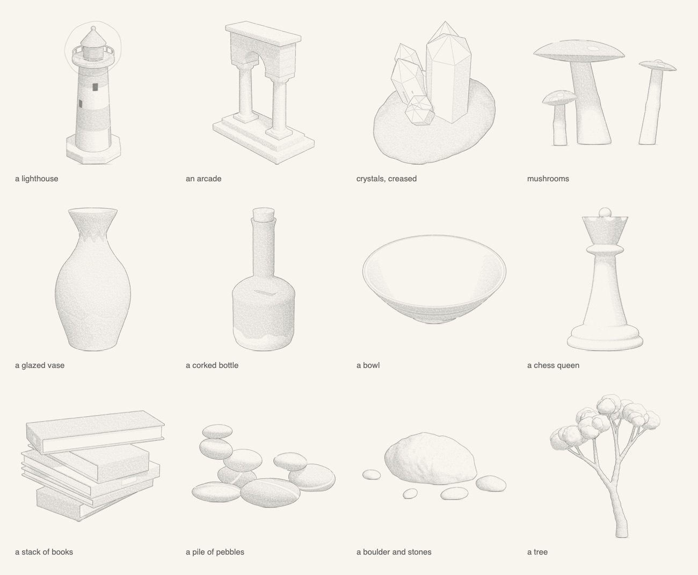

- A Swift package for macOS 13 and later, with no dependencies beyond Apple's frameworks (Foundation, CoreGraphics,
  ImageIO).
- Deterministic: the same model, view and seed give the same drawing, pixel for pixel.
- It began as the drawing engine of a game's illustrated field guide.

## Gallery

Every subject below is a short function in [Examples/Gallery](Examples/Gallery), its proportions, view and light drawn
from a seed. None of them was tuned for the engine.

<p>
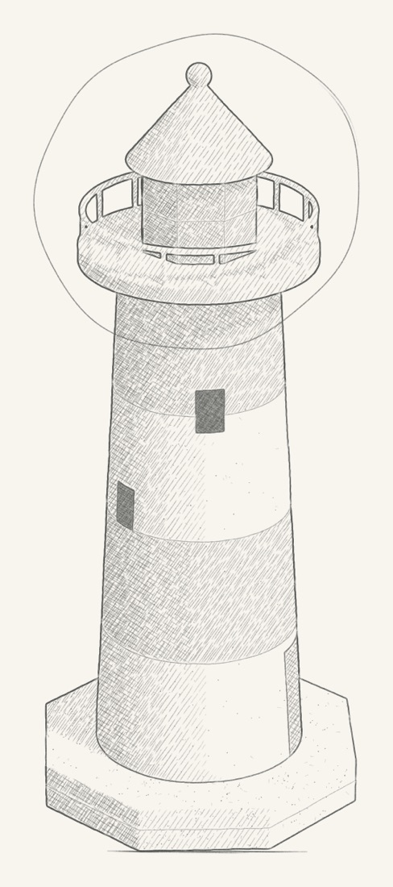
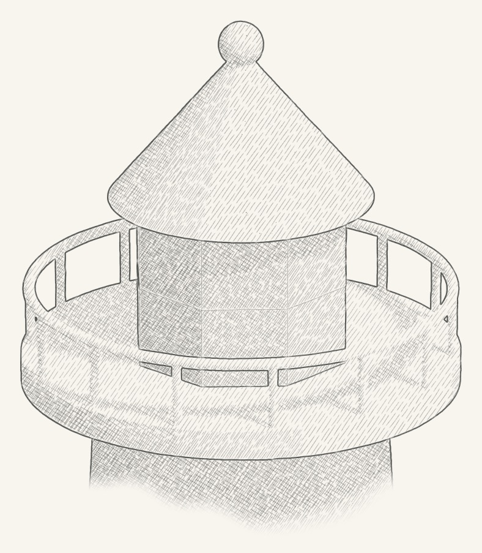
</p>

A lighthouse, and a close-up of its lantern ringed on the view (`drawDetail`). The stripes, door, windows and panes
are regions of its surface; a line is drawn wherever the region changes.

<p>
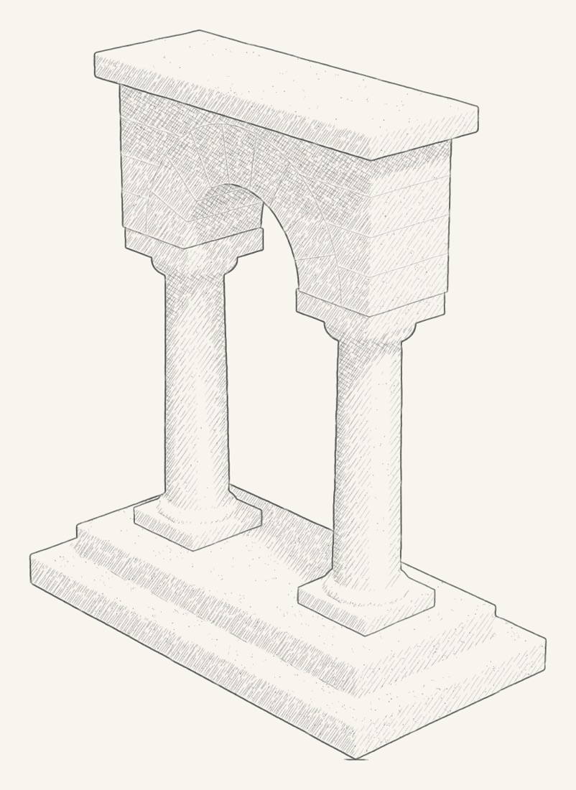
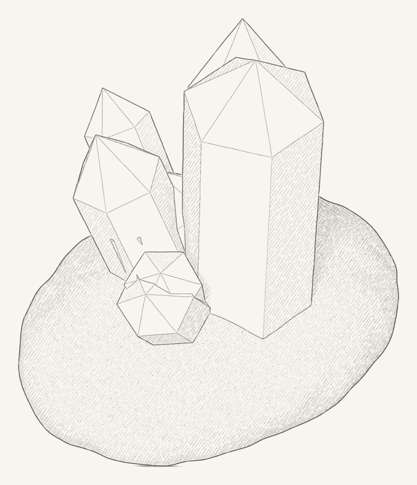
</p>

An arcade, its voussoirs and courses drawn as regions; crystals on a rock, each crystal a single region whose facets
are traced as creases.

<p>
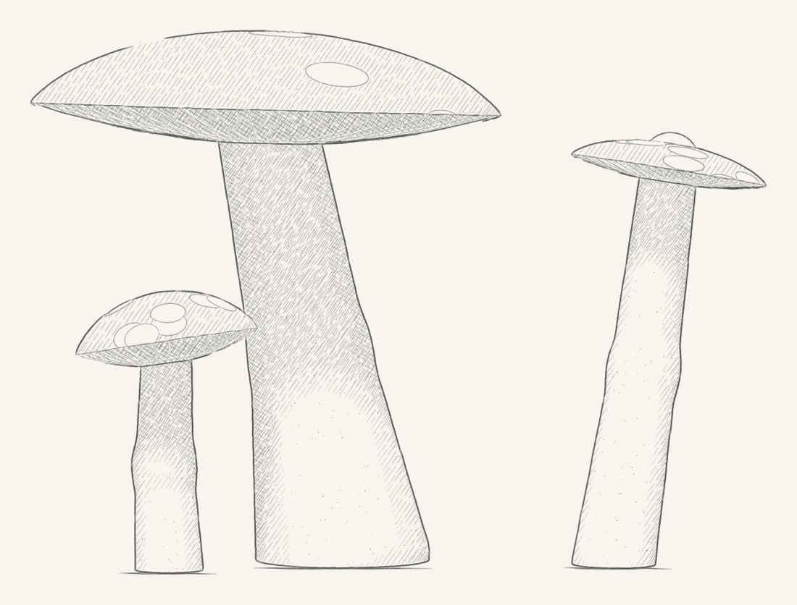
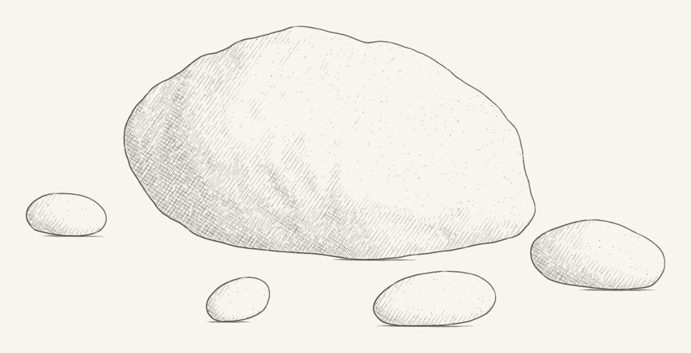
</p>

Mushrooms from a low eye, gills and spots as regions; a boulder and its stones, lit from the upper right
(`drawView(…, light:)`).

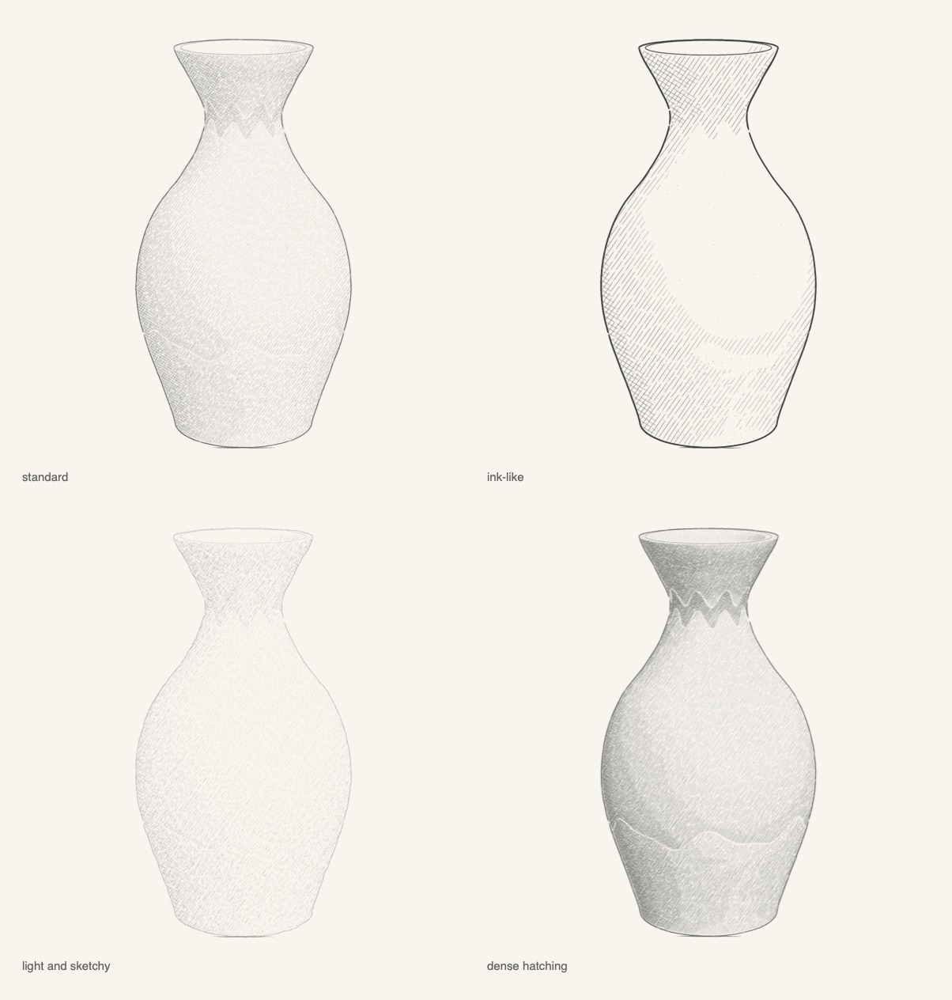

One vase, one view, four hands: the standard style, an ink-like one, a light and sketchy one, and dense hatching
(see [The Style](#the-style)).

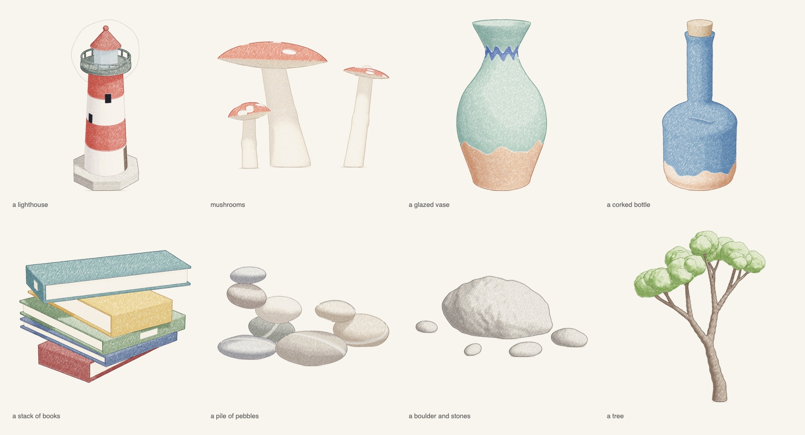

The same models in coloured pencils (`Style.colouredPencil` and a palette per subject, in
[Colour.swift](Examples/Gallery/Colour.swift)): each region's own pencil laid in one direction, crossed by a cool shade
pencil where the light falls away, outlines in a deeper shade of the region they border.

## Quick start

```sh
git clone https://github.com/ocho-git/graphite.git
cd graphite
swift build -c release
swift run -c release graphite              # renders every example into Examples/output/
swift run -c release graphite mug gallery  # or some of them: mug, book, tree, leaf, crystal, gallery, styles, colour
```

Each drawing is written as a PNG (graphite on a transparent background) and as a JPEG preview on paper.

The examples are in [Examples/](Examples): [Mug.swift](Examples/Mug.swift) (a subject written from scratch, three views
and a detail), [Book.swift](Examples/Book.swift) (a few boxes and their regions, drawn as a turnaround in graphite and
in colour), [Tree.swift](Examples/Tree.swift) (a tree grown by `Brancher` on the primitive scene),
[Leaf.swift](Examples/Leaf.swift) (a close study drawn from 2D vector shapes), [Crystal.swift](Examples/Crystal.swift)
(a faceted crystal as one region, without and with creases) and the [gallery](Examples/Gallery).

To use it in your own package:

```swift
.package(url: "https://github.com/ocho-git/graphite.git", branch: "main")
// and in your target's dependencies:
.product(name: "Graphite", package: "graphite")
```

## A minimal drawing

```swift
import Graphite

// A pebble: one ellipsoid on the ground, a bit lumpy.
let pebble = ShapeSubject()
pebble.add(.init(lo: V3(-0.6, -0.4, 0), hi: V3(0.6, 0.4, 0.5), grounded: true,
                 sdf: { p in sdEllipsoid(p - V3(0, 0, 0.2), V3(0.55, 0.38, 0.22)) + 0.01 * vnoise3(p * 9) },
                 material: { _, _, _ in Material(value: 0.25, stipple: 1.5) }))

let view = drawView(pebble, .elevation(az: -.pi / 2, eyeZ: 0.6, dist: 4))
writePNG(view.image, to: "pebble.png")
```

`drawView` frames the subject, marches it at two samples per pixel, draws it and trims it. `drawDetail(subject,
parent: view, target:, radius:)` draws a closer study of a point of a view and tells you where to ring it on the
parent. Both take an optional `light:`, the direction toward the light; by default it is the view's own, from the
upper left of the picture, and a detail's is its parent's. If the framing pass sees nothing (empty bounds, a distance
that never reaches the surface, a view that looks away), `drawView` returns one transparent pixel and says why in
`drawing.error`.

`ShapeSubject` is the quickest way to write a shape of a few parts: closures, no class. It draws as fast as the same
shape written as a class. Keep its closures' captures strong: an `[unowned x]` or `[weak x]` capture costs a reference
count on every call, from every core, and that alone can make a drawing a hundred times slower. For many parts, or the
optional answers below, write a class.

## Drawing with an AI model

Graphite needs a model, not a word. A language model that writes Swift is a good way to get one: most of the gallery,
and a field guide of some 200 drawings, were made that way. The split is clean:

- **The look is the engine's.** Lines, hatching, paper and colour come out the same whoever wrote the model.
- **The likeness is the model writer's.** Proportions, parts, the features that make it *this* thing. A stronger model
  gets more of it right the first time, most of all for living things (a bird's posture, a tree's branching). For
  simple objects (a book, a mug, a pebble) most capable models do fine.

What matters as much as which model: **a loop with eyes**, and **reference**.

1. **Brief**: the subject, its real size and proportions (from a source, not from memory), the 3–5 features that make
   it recognisable, the views and how large they'll be shown.
2. **Model** the silhouette in true proportions from a few primitives.
3. **Render a turnaround**: `turnaround(subject)` draws it from the front, the side, three-quarter and above on one
   sheet. Look at it.
4. **Critique against the brief** in words: does it read at a glance? Are the proportions right? Anything floating or
   missing? A line everywhere one belongs?
5. **Fix and render again**, with the same seed. Two to four rounds is normal. Then the details and close-ups.

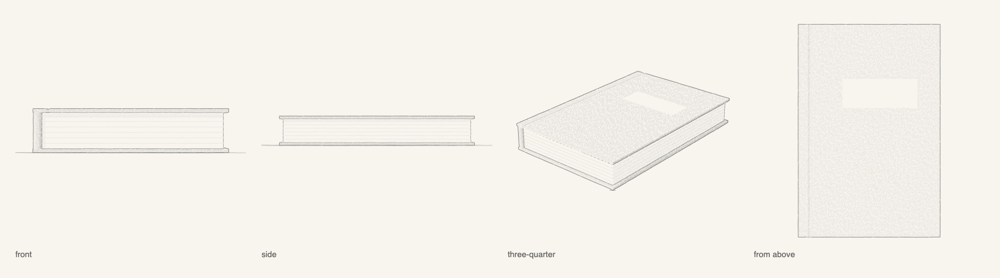

[Book.swift](Examples/Book.swift) is "a book" written this way, in three rounds:
1. **Round one** read as a box with paper in it.
2. **Round two** pressed in the hinge groove along the spine, which is what makes a hardcover look like one. It drew
   nothing: too shallow to make a line from its depth.
3. **Round three** made the groove a region of its own, and the line appeared, because a line is drawn wherever the
   region changes.

That's the kind of thing the loop catches and a single pass doesn't.

[AGENTS.md](AGENTS.md) has the whole guide: the loop, rules of thumb (every line is a region boundary; nothing thinner
than two pixels as a distance field; darkness is a material, not a style; a close-up is a closer study, not a crop),
and a brief to hand a model. Coding agents that read `AGENTS.md` (or `CLAUDE.md`, which points to it) pick it up when
they open the repository.

## How it works

```
Subject (distance field, regions, materials)
   │  render: sphere tracing, soft shadow, contact occlusion
   ▼
GBuffer (per sample: region id, depth, normal, tone, stipple, fills)
   │  ToneMap: averaged to drawn pixels
   ▼
the pencil, onto a Sheet (graphite 0…1 per pixel, the paper's grain; in colour, what its pencils absorb)
   openings → hatching → stipple → contours → your extras → ground strokes
   ▼
image: graphite colour, alpha from the graphite (or the pencils' mix), trimmed to the ink → PNG
```

1. **The subject** ([Subject.swift](Sources/Engine/Subject.swift)) is a signed-distance scene split into parts. For
   any point it gives the distance to the nearest surface and which part that is (`sceneSDF`), and for a hit it gives
   a **region id** (`subID`) and a **material**. Region ids decide where lines go: a contour is drawn wherever two
   neighbouring samples show different regions. So a glaze line, a window, a feather patch or a plank seam is just a
   region boundary. Ids pack a part, a kind and an index (`SurfaceID.make(part, kind, index)`), so rules can be written
   per kind. A sharp edge inside one region draws nothing unless you ask for creases (below).
2. **The render** ([Render.swift](Sources/Engine/Render.swift), [March.swift](Sources/Engine/March.swift)) marches one
   ray per sample, finds the normal by central differences, and works out the light's tone: Lambert from the light,
   softened cast shadows and contact occlusion. The material turns that into the drawn tone (its own darkness, how much
   shade it takes, a fixed tone for openings, a floor for undersides). All the march's tolerances scale with one
   `unit`, so a pebble and a garden are marched at the same pixel scale. Shadows and occlusion are the costly part;
   samples of one pixel can share them (`ShadeSharing`).
3. **The tone map** averages the samples to drawn pixels: tone, coverage, the region at the centre, the stipple density.
4. **The pencil** ([Pencil.swift](Sources/Engine/Pencil.swift), [Sheet.swift](Sources/Engine/Sheet.swift)):
   - every mark is a `Sheet.stroke`: round-capped segments whose width and pressure vary along it; graphite is laid
     through the paper's tooth (light pressure only touches the grain's peaks) and a stroke never darkens a pixel twice
     where it overlaps itself;
   - **openings** get a soft fill under everything (the darkest thing on the page);
   - **hatching**: five layers of parallel dashes at 55° and −32°, each starting at a tone threshold and pressed harder
     in deeper shade, broken where the region changes;
   - **stipple**: dots and short flecks, clustered, denser in the shade, scaled by the material;
   - **contours** ([Contours.swift](Sources/Engine/Contours.swift)): the region boundaries (and, if you ask, the
     creases inside a region) are traced as chains of cracks between samples, each weighted (silhouettes heavy,
     occluding edges strong, folds by their angle, drawn features by kind: `ContourRules`), smoothed, resampled and
     drawn as a hand would: in overlapping strokes of 70–190 px with a slow sway and a tremor, tapered at both ends,
     pressed harder where they border shade;
   - **ground strokes**: a short double stroke under each part that stands on the ground, never over a part in front.
5. **Finer than the marcher** ([Strokes3D.swift](Sources/Engine/Strokes3D.swift)): twigs, needles, veins and fin rays
   are 3D strokes (`Stroke3D`, as wide as the thing they draw) or 3D curves drawn as contours (`Curve3D`), projected
   and hidden wherever the buffer holds something nearer; small flat marks (`Mark3D`: blossoms, leaves) are outlined,
   filled or kept free of hatching. Thin sheets (leaves, petals, blades) can also be triangle **cards**
   ([Cards.swift](Sources/Engine/Cards.swift)) rasterised straight into the buffer, so they get contours and hatching
   like everything else.
6. **2D studies** ([Canvas2D.swift](Sources/Engine/Canvas2D.swift)): for a magnified detail you can skip 3D: fill
   shapes with a tone (lit from the upper left), give them outlines and veins, and the same hatching, stipple and line
   drawing turn them into pencil.
7. **Output** ([Output.swift](Sources/Engine/Output.swift)): graphite colour #3a3d3a with alpha
   `clamp(graphite^0.92 × 0.9)`, premultiplied sRGB, trimmed to the ink with 4 % padding. In colour, each pixel's
   light let through by its pencils (`exp(−absorbance)` per channel), written as the premultiplied colour that lays
   exactly that over white paper.

## Adding a subject

Write a class that conforms to `Subject` (see [Mug.swift](Examples/Mug.swift) for a complete one):

```swift
final class Lantern: Subject {
    var bounds: (lo: V3, hi: V3) { (V3(-0.4, -0.4, 0), V3(0.4, 0.4, 1.6)) }   // everything the marcher can hit
    var partCount: Int { 2 }
    func grounded(_ i: Int) -> Bool { i == 0 }                                // a ground stroke under part 0

    func sceneSDF(_ p: V3) -> (Double, Int) { … }   // nearest distance, and the part it belongs to
    func partSDF(_ i: Int, _ p: V3) -> Double { … } // one part's distance (for its normal)
    func subID(_ i: Int, _ p: V3, _ n: V3) -> Int32 { SurfaceID.make(i, kind) }        // the drawn region
    func material(_ id: Int32, _ p: V3, _ n: V3) -> Material { … }                      // its tone
}
```

<p>
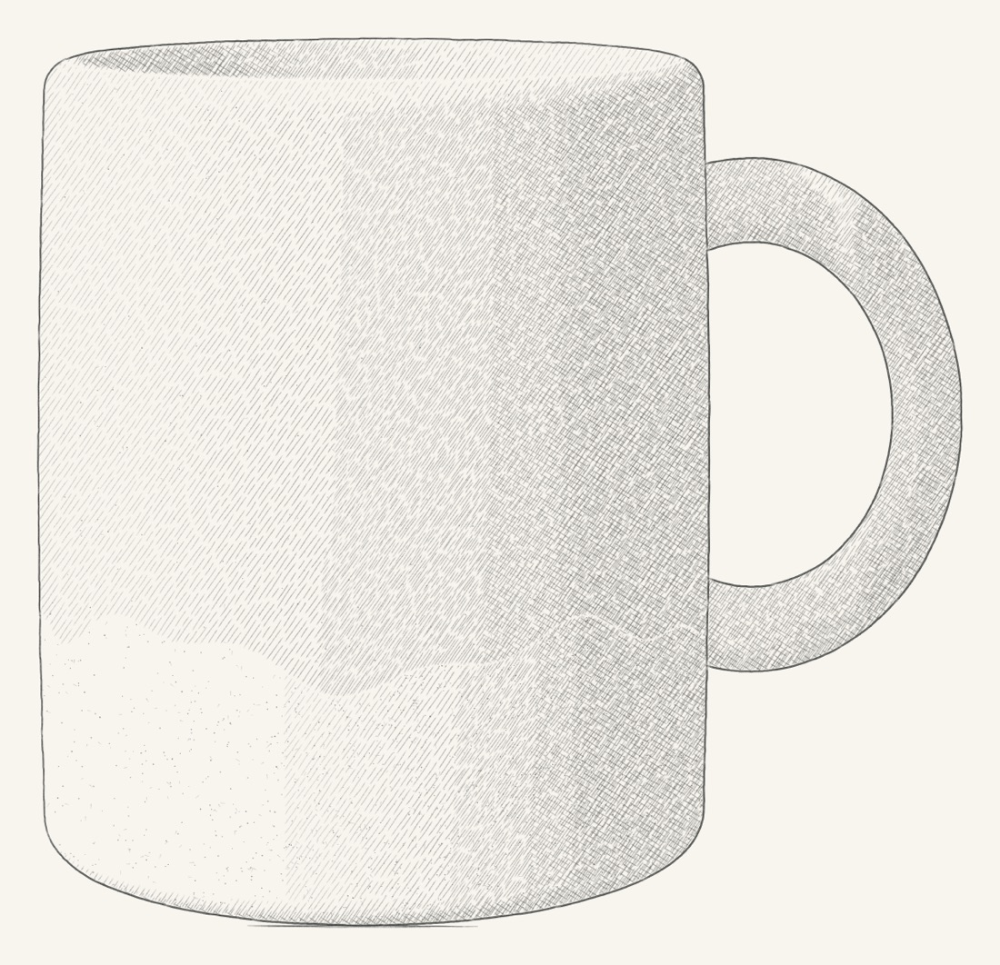
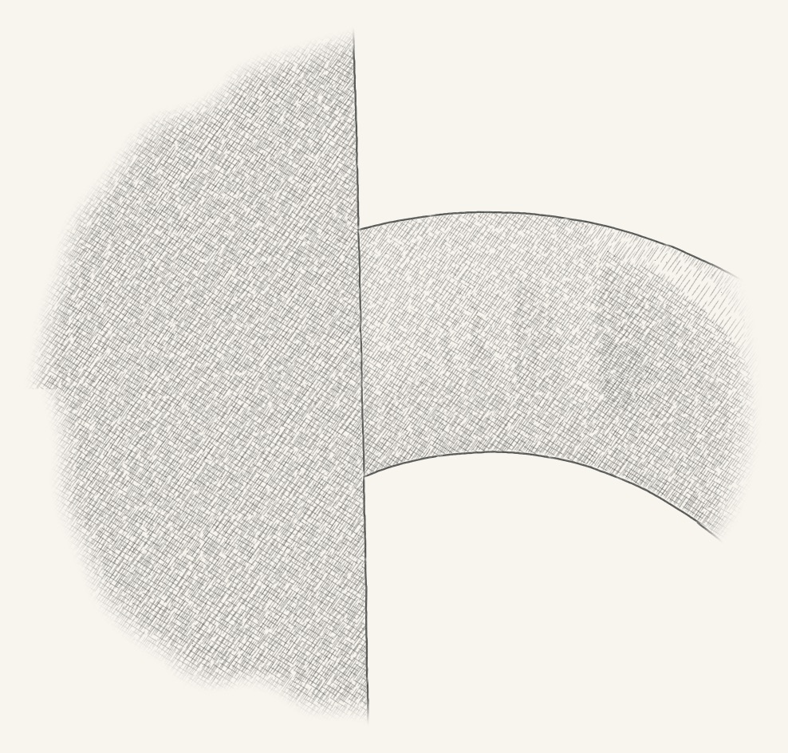
</p>

The mug of [Mug.swift](Examples/Mug.swift): two parts (body and handle) and four regions (bare clay, glaze, the glazed
inside, the handle), and a close-up of where the handle meets the body.

- **Model in true proportions**, in any unit; the drawing scales to the view. Use the library in
  [SDF.swift](Sources/Engine/SDF.swift): spheres, ellipsoids, boxes, capsules, round cones (tapered tubes), capped cones,
  tori, planes, regular prisms and polygons, 2D ellipses, rounded rectangles and polygons for plans and profiles,
  smooth unions, intersections and subtractions, rounded edges, shells, splines.
- **Split into parts** where you want a line between pieces (a handle against a body), and into **regions** where a
  surface changes (a glaze line, a window, a band). Keep a part's distance field in its own box and test the box first:
  the marcher calls `sceneSDF` millions of times.
- **Materials**: `Material(value:)` for a darker surface (0 white … 1 black), `fixedTone` for an opening or white
  paper, `minTone` for an underside, `stipple` for speckled stone, `fill: 1` for an opening's dark fill.
- **Line weights**: `SketchOptions.rules` (`ContourRules`) sets silhouettes, occluding edges, creases and per-kind
  floors; a subject can also answer `edgeWeight(a, b)` for its own seams.
- **Many small primitives** (a tree, a shrub): use `PrimitiveBuilder` / `PrimitiveScene` (cones, ellipsoids, tori in
  smoothly united groups with surface noise, in a uniform grid), as [Tree.swift](Examples/Tree.swift) does.
- **Trees**: `Brancher` ([Brancher.swift](Sources/Engine/Brancher.swift)) grows one on a `PrimitiveBuilder`: limbs
  that wander, taper and fork two or three ways until their twigs carry leaf clusters, all from one `Rng`. Give it the
  bark's region and a leaf cluster's (from its group), change any of its knobs (steps, wander, taper, forking, spread,
  the leaves, or a `tip` closure for blossoms or needles), and call `grow(builder, from:, dir:, length:, radius:,
  depth:, wood:, rng:)`. Its defaults grow the example tree; the gallery's tree draws its knobs from a seed.
- **Extras**: `drawView(subject, view, options) { camera, buffer, sheet, rng in … }` runs after the contours: draw 3D
  strokes, marks, water lines, anything, with the same pencil.
- **Thin parts' shadows**: the soft shadow's edge widens with the distance from what casts it (about t /
  `march.shadowSharpness` at distance t; 9 by default), so a thin part far above what it shades (a railing, a twig)
  casts a wide, faint shadow. Raise `options.march.shadowSharpness` to 16–32 for a narrower, firmer one.
- Optional answers: `missID` (seen through an opening), `exactHit` (thin planes the marcher should not step to:
  wings), `groundZ` (a plane that takes the cast shadow in views from above), `groundFoot` (a foot that may hide behind
  a leg), `shadowSDF` / `occlusionSDF` (what casts shadows, what occludes), `willRender` (to keep the unit, camera or
  light while you are sampled).

For full control, skip `drawView` and call the steps yourself: `render(subject, camera:, into:, light:, options:)`,
`ToneMap(buffer)`, `drawOpenings`, `drawHatching`, `drawStipple`, `traceContours` + `drawChains`, `groundStroke`,
`sheet.trimmed()`.

## Creases

Lines are traced where the region changes, so a sharp edge inside one region draws nothing, and a faceted subject
would need a region per facet. Set `rules.creaseAngle` instead (degrees; 30–45 suits sharp edges; off by default):
wherever the surface normal turns by more than that between neighbouring samples of one region, a line of weight
`rules.crease` (0.55) is traced too.

<p>
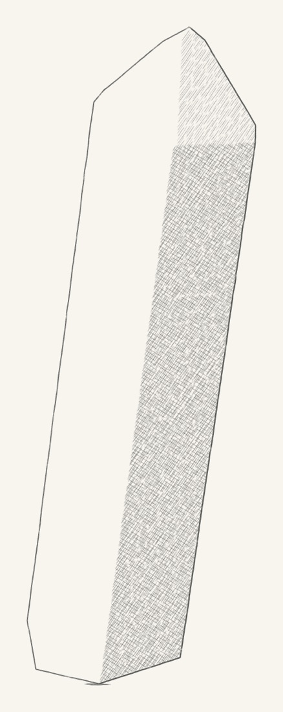

</p>

[Crystal.swift](Examples/Crystal.swift): a quartz crystal as a single region, without and with creases. Curved
surfaces stay unlined at 20–30°; much lower, tight curves and a noisy surface begin to draw. With your own weight
function, `traceContours(g, creases: angle, weight:)` hands it these edges with `a == b`.

## The Style

Everything that sets the look is in one value, `Style` ([Style.swift](Sources/Engine/Style.swift)); `Style.standard` is
the default look. Pass a changed copy in `SketchOptions.style` (or to `Sheet(w:h:seed:style:)`). The gallery's
[styles](Examples/Gallery/Gallery.swift) are three such copies.

| knob | default | what it does |
| --- | --- | --- |
| `pencil.red/green/blue` | 0x3a, 0x3d, 0x3a | the graphite colour |
| `pencil.opacity`, `pencil.gamma` | 0.9, 0.92 | alpha = clamp(graphite^gamma × opacity): how black full graphite gets |
| `paper.toothBase`, `paper.toothPressure` | 0.3, 0.55 | how much grain shows through light strokes (toothBase 1: smooth paper) |
| `paper.grainScale` | 1 | the size of the paper's grain |
| `line.smoothing` | 1.15 | how much a traced line is smoothed (samples) |
| `line.strokeMin/Max` | 70, 190 px | a long edge is drawn in strokes of this length |
| `line.wobble`, `line.wobbleLength` | 1.1 px, 38 px | the hand's slow sway across a line |
| `line.tremor`, `line.tremorLength` | 0.3 px, 6.5 px | the quick tremor |
| `line.widthMin/Range`, `line.pressureMin/Range` | 0.6 + 1.55·w, 0.2 + 0.78·p | line width and pressure from the edge's weight |
| `line.start…`, `line.end…` | | the taper at each end of a stroke |
| `line.shadeBase/Gain` | 0.82, 0.38 | lines bordering shade are pressed harder |
| `hatching.layers` | 55°/6.2 px ×3, −32°/6.0 px ×2 | angle, spacing, phase, tone threshold, pressure range and width of each layer |
| `hatching.dashMin/Max`, `gapMin/Max` | 14–40 px, 1.5–5 px | the dashes along a hatch line |
| `hatching.tilt`, `shift`, `bow` | 0.035 rad, 0.5 px, 0.6 px | each dash's irregularity |
| `hatching.followLight` | false | turn the hatching's angles with the light (`drawView(…, light:)`): by as much as the light turns from the upper left, seen in the picture |
| `stipple.density` | 0.010 | dots per pixel at stipple 1 (scaled by tone and clustering) |
| `stipple.dots`, `dotRadius…`, `dotPressure…` | 0.75, … | dots versus flecks, their size and pressure |
| `fill.opening`, `fill.through` | 0.42, 0.2 (+ grain) | the soft fills of openings and of what is seen through them |
| `ground.width`, `ground.pressure…`, `ground.sway…` | 1.6 px, … | the ground stroke |

| `colour` | nil | coloured pencils (see below); nil draws in graphite |
| `HatchLayer.ink` | `.local(1)` | in colour, the pencil a hatch layer lays: the region's own (`.local(k)`, k times over), the shade pencil, or a fixed one |

Line weights per kind (silhouettes, occluding edges, creases, seams) are not style but rules: `ContourRules`.

## Coloured pencils

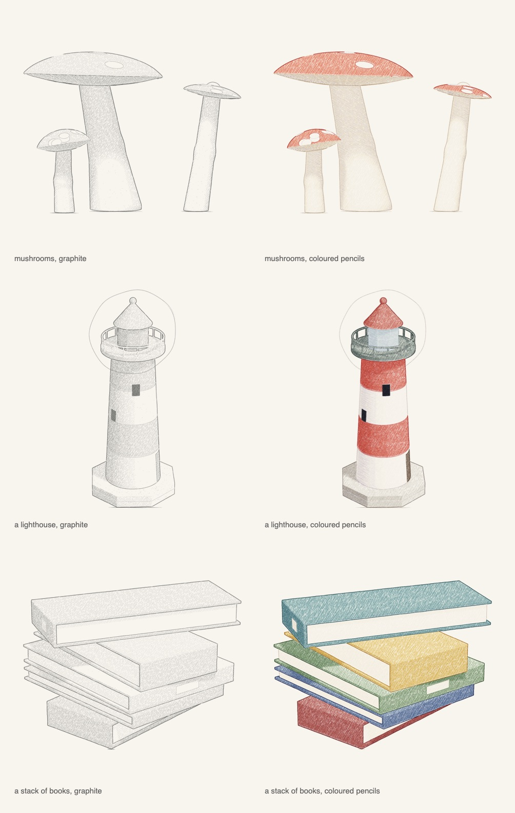

Give the drawing `Style.colouredPencil` and a palette: each region's own pencil, by its id.

```swift
var o = SketchOptions()
o.style = .colouredPencil
o.palette = { id in
    switch SurfaceID.kind(id) {
    case Kind.cap.rawValue:  return Pigment(hex: 0xC9452F)
    case Kind.stem.rawValue: return Pigment(hex: 0xEDE2C8)
    default:                 return nil          // the style's fallback pencil
    }
}
let d = drawView(mushrooms, view, o)
```

- **Pencils mix like pigment.** Beside its graphite, a coloured sheet keeps what each pixel's pencils absorb, per
  channel. A pencil adds its absorbance (`−ln` of its colour) by as much graphite as it laid, so yellow over blue gives
  green, a pencil over itself deepens, and once the paper's tooth fills up a layer adds less. `Pigment` has
  `deepened(k)` (laid k times) and `mixed(_:_:)`.
- **The passes pick their pencils** from `Style.Colour`:

| knob | default | what it does |
| --- | --- | --- |
| `hatching.layers[i].ink` | own ×1, own ×1, shade, own ×1.8, own ×2.6 | the preset's five layers: the region's colour over all of it (paper left at the brightest lights), again in the half-tones, the shade pencil crossing it, then deeper |
| `shade` | a cool violet grey | the shade pencil |
| `line`, `lineShade` | `.local(2.6)`, 0.25 | a line is its region's pencil deepened, with a quarter of the shade pencil in it (the darker region where two meet) |
| `stipple`, `opening` | `.local(2.2)`, `.local(2.4)` | the speckle and openings' fill |
| `ground` | a warm grey | the ground strokes |
| `fallback` | a warm grey | regions the palette leaves out |

- The preset also sets a coarser tooth, longer and closer dashes, and a wider pressure ramp, so the colour builds up
  with the tone.
- Greys and very pale colours come out pale: choose a pencil a shade deeper than the colour you want to see.
- Drawings in graphite are unchanged by all of this; the examples render byte for byte as before.

## Performance

- Rendering is CPU-only and runs the march on all cores (`DispatchQueue.concurrentPerform` over rows); the pencil
  passes run on one core. A 1200 px drawing of a modest subject takes well under a second to a few seconds on a
  recent Mac; a dense tree or a whole scene takes tens of seconds.
- The cost is almost all in `sceneSDF`. Give every part a bounding box and skip it when the box is farther than the
  best distance so far (`ShapeSubject` does this); for thousands of primitives use `PrimitiveScene`, which buckets them
  in a grid.
- Keep reference counting out of `sceneSDF`. It runs on every core at once, and a retain and release of one shared
  object on every call (a class captured `unowned` or `weak`, a closure copied out of an array) bounces a single
  counter between the cores. That once made the mug a hundred times slower as a `ShapeSubject` than as a class;
  `ShapeSubject` now reads its parts from plain memory and draws the mug in the same 0.35 s as the class.
- Shadows and occlusion dominate the shading: `ShadeSharing.perPixel` (the `drawView` default) shades one sample per
  pixel and lets the others borrow it when they show the same region; `.perPart` and `.byNormal` share within a pixel
  by part or by facing.
- Build with `-c release`; in your own package, `-Ounchecked` (an unsafe flag in your target) helps the distance
  functions a little more. A distance field that is only a bound (blended ellipsoids, noise) wants a smaller
  `MarchSettings.stepScale` (0.7) and more steps.
- Two samples per pixel (`ss = 2`) is the default and enough; the coarse framing pass costs little.

## License

MIT: free to use, modify and include in any project, commercial or not. See [LICENSE](LICENSE).
